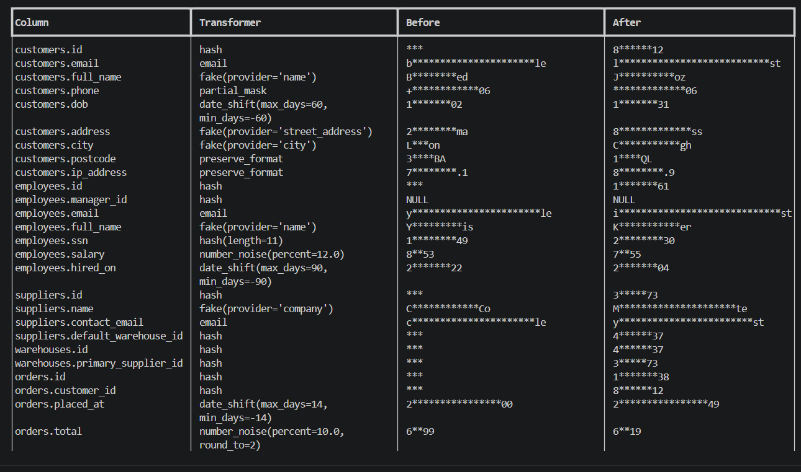

# Masker

Masker makes a **safe copy of your database**. It copies your real rows into a separate database and replaces personal data (names, emails, phone numbers, …) with fake or hidden values.

Use it when you need realistic data for testing, staging, demos or support, without exposing real customer information.

- Works with **SQLite, PostgreSQL and MySQL/MariaDB**
- Your source database is opened **read-only** — Masker never changes it
- The same input always gives the same masked output, so **relationships between tables still work**



> Masking lowers the risk of leaking personal data, but it does not make data legally "anonymous". Always review the result before sharing it.

---

## Install

Requires Python 3.10+.

Masker is not on PyPI yet, so install it from this repository:

```bash
git clone https://github.com/zahidhasann88/masker && cd masker
pip install .                 # SQLite works out of the box
pip install '.[postgres]'     # add PostgreSQL support
pip install '.[mysql]'        # add MySQL / MariaDB support
```

After the first PyPI release it will be `pip install masker-db` (the command is still called `masker`).

---

## How to use it

### 1. Create a rules file

```bash
masker init --source "postgresql://user@localhost:5432/app" --output masker.yaml
```

This looks at your database and writes `masker.yaml` with a rule for every column. Columns that look like personal data get a suggested rule. **Open the file and check every suggestion** — nothing is decided until you review it.

### 2. Set a secret key

```bash
# macOS / Linux
export MASKER_SECRET_KEY="$(python -c 'import secrets; print(secrets.token_urlsafe(48))')"
```

```powershell
# Windows (PowerShell)
$env:MASKER_SECRET_KEY = python -c "import secrets; print(secrets.token_urlsafe(48))"
```

The key controls how values are masked. Keep it secret, like a password — never put it in `masker.yaml` or commit it.

### 3. Check your rules

```bash
masker scan     --source "$SOURCE_URL" --rules masker.yaml --strict   # find columns you forgot
masker validate --source "$SOURCE_URL" --rules masker.yaml            # check rules match the schema
masker run      --source "$SOURCE_URL" --target "$TARGET_URL" --rules masker.yaml --dry-run   # preview only
```

### 4. Make the copy and verify it

```bash
masker run    --source "$SOURCE_URL" --target "$TARGET_URL" --rules masker.yaml
masker verify --source "$SOURCE_URL" --target "$TARGET_URL" --rules masker.yaml
```

`verify` checks the copy for real values that slipped through and exits with an error if it finds any.

### Try the demo

```bash
python examples/demo.py
```

---

## The rules file

```yaml
version: 1

tables:
  customers:
    action: copy
    columns:
      id:         {transformer: hash}
      email:      {transformer: email}
      full_name:  {transformer: fake, params: {provider: name}}
      phone:      {transformer: partial_mask, params: {keep_last: 4}}
      notes:      {transformer: redact}
      created_at: {transformer: keep}

  orders:
    action: copy
    columns:
      id:          {transformer: hash}
      customer_id: {transformer: hash}   # still matches customers.id

  audit_log:
    action: skip                         # not copied at all
```

**Table actions:** `copy` (all rows, default), `skip` (don't copy), `truncate` (create the table, no rows), `subset` (copy only `subset_rows` rows).

See [`examples/masker.yaml`](examples/masker.yaml) for a full example with all settings.

---

## Transformers

A transformer decides how a column is masked. Run `masker transformers` to list them all.

| Transformer | What it does | Example |
|---|---|---|
| `fake` | Realistic fake value (name, city, …) | `Jane Doe` → `Mark Lee` |
| `email` | Fake email on a safe domain | `jane@corp.com` → `bravo.fox12@example.test` |
| `hash` | Keyed hash; keeps IDs joinable | `42` → `918273645` |
| `partial_mask` | Hide all but some characters | `4111111111111111` → `************1111` |
| `preserve_format` | Same shape, different characters | `555-0142` → `569-8342` |
| `date_shift` | Move dates by a few days (same date always moves the same way) | `1990-05-10` → `1990-05-27` |
| `number_noise` | Change numbers by a small percent | `1000` → `1063` |
| `regex_replace` | Replace text matching a pattern | `https://corp.com/x` → `https://example.test/x` |
| `shuffle` | Mix values between rows | — |
| `redact` | Replace with a fixed marker | `call me…` → `[REDACTED]` |
| `constant` | Replace with one fixed value | `US` → `XX` |
| `null` | Empty the column | `secret` → `NULL` |
| `keep` | Copy unchanged (on purpose) | `2024-01-01` → `2024-01-01` |

Use `keep` when a column is safe — it tells Masker you checked it. Columns with **no rule** are reported as possibly unsafe.

---

## Safety

- The source database is opened read-only.
- Masker refuses to copy a database onto itself.
- Masker refuses to write into a target that already has data, unless you pass `--allow-non-empty`.
- Passwords and keys are hidden from all output.
- Every run lists the columns that were copied without masking.

## Things to know

- **Free text** (like `notes` or `bio`) can hide personal data inside sentences. Use `redact` or `null` for these columns.
- **Combinations** of safe-looking columns (birth date + postcode + gender) can still identify a person.
- **No incremental runs** — each run copies the selected tables again.
- `fake` is the slowest transformer; on very large tables prefer `hash` or `partial_mask`.

---

## Development

```bash
git clone https://github.com/zahidhasann88/masker && cd masker
python -m venv .venv && source .venv/bin/activate   # Windows: .venv\Scripts\activate
pip install -e '.[dev,postgres,mysql]'
make check    # lint, type-check and tests
```

## License

MIT — see [LICENSE](LICENSE).
